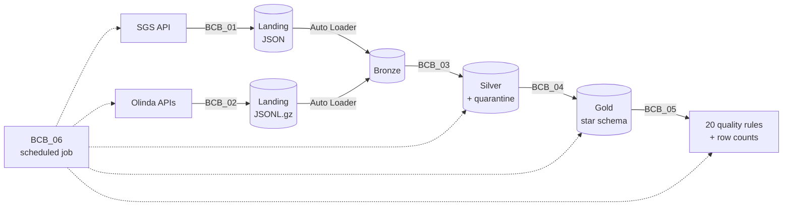

# Brazilian Central Bank data pipeline on Databricks

[Versão em português](README.md)

A pipeline that pulls public data from the Brazilian Central Bank (BCB) out of three sources, processes it on Databricks in bronze, silver and gold layers, and delivers an analysis-ready star schema. It runs on its own every weekday at 6 pm and stops if any critical data quality rule fails.

The question behind the project: **when the Selic policy rate goes up, how much of it reaches the rate banks actually charge?** The data to answer it exists, but it is spread across different APIs, gets revised after publication and carries errors you cannot see by eye.

## Sources

| Source | What it holds | How it is extracted |
|---|---|---|
| **SGS** | Selic target, CDI, USD/BRL (PTAX), IPCA inflation (monthly and 12 months), IGP-M and unemployment, since 2015 | Per series, in 5-year windows (the API rejects ranges over 10 years) |
| **Olinda · interest rates** | Rate charged by each financial institution for each credit product, since 2012 | OData paged by month, in parallel |
| **Olinda · Focus survey** | Annual market expectations (median, mean, std dev, min, max and respondents), since 2014 | OData paged by month, in parallel |

Sources live in configuration tables (`economia.config`), so adding a new series is an `INSERT`, not a code change.

## Architecture



Everything lives in the `economia` Unity Catalog catalog, with one schema per layer (`landing`, `bronze`, `silver`, `gold`) plus `config` and `monitoramento`.

- **Bronze (`BCB_01`, `BCB_02`)**: every API response is stored exactly as received in a landing volume and loaded with Auto Loader (`availableNow`), keeping the source file and load time. If something breaks later, it can be reprocessed without calling the APIs again. Retries with backoff on 429 and 5xx, and also when the API returns 200 with an invalid body. For Olinda, the schema is inferred as text and versioned; typing happens in silver.
- **Silver (`BCB_03`)**: types, validates and deduplicates. Invalid records are not dropped: they go to a quarantine table with the reason (`data_invalida`, `chave_incompleta`, `valor_invalido`, `periodo_invertido`, `campos_inesperados`…). Valid ones are applied with `MERGE`, and the latest version of each key wins.
- **Gold (`BCB_04`)**: star schema with declared primary and foreign keys and a comment on every column. Tables are created once and reloaded with `INSERT OVERWRITE`, keeping schema and constraints.
- **Quality (`BCB_05`)**: 20 rules written on every run to `monitoramento.qualidade_resultados`, plus the row count of every table in `monitoramento.volumetria`.
- **Job (`BCB_06`)**: creates or updates the job as code, with the Databricks SDK.

## Incremental load and BCB revisions

The Central Bank revises data it has already published, so "fetch only what is new" would miss those corrections. The pipeline starts from the last loaded date but always looks back a little:

- **SGS**: reprocesses the last 30 days of each series.
- **Olinda**: reprocesses the last month of each resource.
- **Silver**: `MERGE` only updates a row when the value changed and records when (`_atualizado_em`). For Olinda sources, only bronze records loaded after the previous run are read.

## Gold model

| Table | Grain | Purpose |
|---|---|---|
| `dim_calendario` | day | shared time axis (2012 to 2027) |
| `dim_serie` | SGS series | attributes of each indicator |
| `fato_indicador` | series × day | original values of every series |
| `fato_macro_mensal` | month | 12-month Selic, CDI and IGP-M, IPCA, USD, real interest rate and inflation target |
| `dim_instituicao` | financial institution | latest name per CNPJ root |
| `dim_modalidade` | segment × product | credit product split from rate type |
| `fato_taxa_juros` | period × institution × product | rate charged and ranking position |
| `dim_indicador_focus` | indicator × detail | indicators projected in Focus |
| `fato_expectativa_anual` | date × indicator × year × basis | market projection statistics |

`fato_macro_mensal` already delivers the real interest rate (Selic and CDI net of 12-month IPCA) and flags months where inflation was above the target ceiling.

## Data quality

Severity **erro** stops the job; **aviso** is only recorded.

| Type | Rules | Severity |
|---|---|---|
| Duplicate keys in fact tables | 3 | error |
| Orphan foreign keys (institution, product, indicator, calendar) | 6 | error |
| Same row count in silver and gold | 2 | error |
| Zero or negative USD rate | 1 | error |
| Annual rate outside 0–1000%, monthly rate above annual | 2 | warning |
| Focus median outside min–max, Focus without respondents | 2 | warning |
| Atypical monthly IPCA (above 5% in absolute value) | 1 | warning |
| Stale source (SGS, interest rates, Focus) | 3 | warning |

## Results

- **2.8 million rows** of interest rates from **279 institutions** across **23 credit products**.
- The quality rules found **3,307 rates outside any reasonable range** that would have slipped into any analysis unnoticed. They were flagged, not deleted, until the cause was understood.
- A full job run took **4 to 7 minutes**.

## Scheduled job

`bcb_pipeline_diario`, Monday to Friday at 6 pm (Brasília time), on serverless compute:

```
bronze_sgs ────┐
               ├──▶ silver ──▶ gold ──▶ qualidade
bronze_olinda ─┘
```

Each task retries up to 2 times with a 5-minute interval, the job never runs twice at once and sends an e-mail on failure. `BCB_06` can be run again without duplicating the job: if it already exists, its settings are overwritten.

## How to run

1. Import the `notebooks/` folder into your workspace (**Workspace > Import**, or clone this repository into a Databricks Git folder).
2. Run `BCB_00_Setup` to create the catalog, schemas, volumes and configuration tables.
3. Run `BCB_06_Job`. It creates the scheduled job and triggers the first full run.

Works on Databricks Free Edition with serverless compute. The first load fetches the full history since 2012; later loads are incremental.

## Structure

```
notebooks/
  BCB_00_Setup.sql          catalog, schemas, volumes and source configuration
  BCB_01_Bronze_SGS.py      SGS extraction + Auto Loader
  BCB_02_Bronze_Olinda.py   parallel Olinda extraction + Auto Loader
  BCB_03_Silver.sql         typing, quarantine and MERGE
  BCB_04_Gold.sql           star schema
  BCB_05_Qualidade.py       quality rules and row counts
  BCB_06_Job.py             scheduled job as code
```

## License

[MIT](LICENSE)
