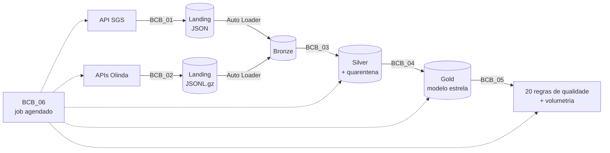

# Pipeline de dados do Banco Central no Databricks

[English version](README.en.md)

Pipeline que busca dados públicos do Banco Central em três fontes, trata no Databricks em camadas bronze, silver e gold e entrega um modelo estrela pronto para análise. Roda sozinho nos dias úteis às 18h e para se alguma regra crítica de qualidade falhar.

A pergunta que motivou o projeto: **quando a Selic sobe, quanto disso chega na taxa que o banco cobra?** Os dados para responder existem, mas ficam espalhados em APIs diferentes, são corrigidos depois de publicados e trazem erros que não aparecem a olho nu.

## Fontes

| Fonte | O que traz | Como é extraída |
|---|---|---|
| **SGS** | Séries de Selic meta, CDI, dólar PTAX, IPCA (mensal e 12 meses), IGP-M e desocupação, desde 2015 | Por série, em janelas de 5 anos (a API recusa intervalos acima de 10 anos) |
| **Olinda · taxas de juros** | Taxa cobrada por instituição financeira em cada modalidade de crédito, desde 2012 | OData paginado por mês, em paralelo |
| **Olinda · Focus** | Expectativas anuais do mercado (mediana, média, desvio, mínimo, máximo e respondentes), desde 2014 | OData paginado por mês, em paralelo |

As fontes ficam em tabelas de configuração (`economia.config`), então incluir uma série nova é um `INSERT`, não uma mudança de código.

## Arquitetura



Tudo fica no catálogo `economia` do Unity Catalog, com um schema por camada (`landing`, `bronze`, `silver`, `gold`) mais `config` e `monitoramento`.

- **Bronze (`BCB_01`, `BCB_02`)**: cada resposta da API é gravada exatamente como chegou num volume de landing e carregada com Auto Loader (`availableNow`), com o arquivo de origem e a hora da carga. Se algo der errado depois, dá para reprocessar sem buscar tudo de novo. Novas tentativas com backoff para 429 e 5xx, e também quando a API responde 200 com conteúdo inválido. No Olinda, o esquema é inferido como texto e versionado; a tipagem fica para a silver.
- **Silver (`BCB_03`)**: tipa, valida e deduplica. Registro inválido não some: vai para uma tabela de quarentena com o motivo (`data_invalida`, `chave_incompleta`, `valor_invalido`, `periodo_invertido`, `campos_inesperados`…). Os válidos entram por `MERGE`, e a versão mais recente de cada chave prevalece.
- **Gold (`BCB_04`)**: modelo estrela com chaves primárias e estrangeiras declaradas e comentário em cada coluna. As tabelas são criadas uma vez e recarregadas com `INSERT OVERWRITE`, preservando esquema e constraints.
- **Qualidade (`BCB_05`)**: 20 regras gravadas a cada execução em `monitoramento.qualidade_resultados`, junto com a contagem de linhas de cada tabela em `monitoramento.volumetria`.
- **Job (`BCB_06`)**: cria ou atualiza o job como código, com o SDK do Databricks.

## Carga incremental e revisões do BCB

O Banco Central corrige dados já publicados, então "buscar só o que é novo" perderia essas correções. O pipeline busca a partir do último dado carregado, mas sempre volta um pouco:

- **SGS**: reprocessa os últimos 30 dias de cada série.
- **Olinda**: reprocessa o último mês de cada recurso.
- **Silver**: o `MERGE` só atualiza a linha quando o valor mudou e registra quando (`_atualizado_em`). Nas fontes Olinda, só entram registros da bronze carregados depois da última execução.

## Modelo gold

| Tabela | Grão | Uso |
|---|---|---|
| `dim_calendario` | dia | eixo de tempo comum aos fatos (2012 a 2027) |
| `dim_serie` | série SGS | atributos de cada indicador |
| `fato_indicador` | série × dia | valores originais de todas as séries |
| `fato_macro_mensal` | mês | Selic, CDI e IGP-M acumulados em 12 meses, IPCA, dólar, juro real e meta de inflação |
| `dim_instituicao` | instituição financeira | nome mais recente por raiz de CNPJ |
| `dim_modalidade` | segmento × modalidade | produto de crédito separado do tipo de encargo |
| `fato_taxa_juros` | período × instituição × modalidade | taxa cobrada e posição no ranking |
| `dim_indicador_focus` | indicador × detalhe | indicadores projetados no Focus |
| `fato_expectativa_anual` | data × indicador × ano × base | estatísticas das projeções do mercado |

A `fato_macro_mensal` já entrega o juro real (Selic e CDI descontados do IPCA 12 meses) e marca os meses em que o IPCA ficou acima do teto da meta do CMN.

## Qualidade de dados

Severidade **erro** interrompe o job; **aviso** só fica registrado.

| Tipo | Regras | Severidade |
|---|---|---|
| Chave duplicada nos fatos | 3 | erro |
| Chave estrangeira órfã (instituição, modalidade, indicador, calendário) | 6 | erro |
| Total de linhas igual entre silver e gold | 2 | erro |
| Dólar zero ou negativo | 1 | erro |
| Taxa anual fora de 0 a 1000%, taxa mensal maior que a anual | 2 | aviso |
| Mediana do Focus fora do intervalo mínimo–máximo, Focus sem respondentes | 2 | aviso |
| IPCA mensal atípico (acima de 5% em módulo) | 1 | aviso |
| Fonte desatualizada (SGS, taxas de juros, Focus) | 3 | aviso |

## Resultados

- **2,8 milhões de linhas** de taxas de juros de **279 instituições** em **23 tipos de crédito**.
- As regras de qualidade encontraram **3.307 taxas fora de qualquer faixa razoável**, que teriam entrado em qualquer análise sem ninguém perceber. Elas ficaram marcadas, não apagadas, até a causa ser entendida.
- O job completo levou **de 4 a 7 minutos** por execução.

## Job agendado

`bcb_pipeline_diario`, de segunda a sexta às 18h (horário de Brasília), em computação serverless:

```
bronze_sgs ────┐
               ├──▶ silver ──▶ gold ──▶ qualidade
bronze_olinda ─┘
```

Cada tarefa tem até 2 novas tentativas com 5 minutos de intervalo, o job não roda em duplicidade e manda e-mail se falhar. O `BCB_06` pode ser executado de novo sem duplicar o job: se ele já existe, a configuração é sobrescrita.

## Como rodar

1. Importe a pasta `notebooks/` no workspace (**Workspace > Import**, ou clone este repositório numa pasta Git do Databricks).
2. Rode o `BCB_00_Setup` para criar catálogo, schemas, volumes e tabelas de configuração.
3. Rode o `BCB_06_Job`. Ele cria o job agendado e já faz a primeira execução completa.

Funciona no Databricks Free Edition com computação serverless. A primeira carga busca todo o histórico desde 2012; as seguintes são incrementais.

## Estrutura

```
notebooks/
  BCB_00_Setup.sql          catálogo, schemas, volumes e configuração das fontes
  BCB_01_Bronze_SGS.py      extração das séries SGS + Auto Loader
  BCB_02_Bronze_Olinda.py   extração paralela das APIs Olinda + Auto Loader
  BCB_03_Silver.sql         tipagem, quarentena e MERGE
  BCB_04_Gold.sql           modelo estrela
  BCB_05_Qualidade.py       regras de qualidade e volumetria
  BCB_06_Job.py             job agendado como código
```

## Licença

[MIT](LICENSE)
